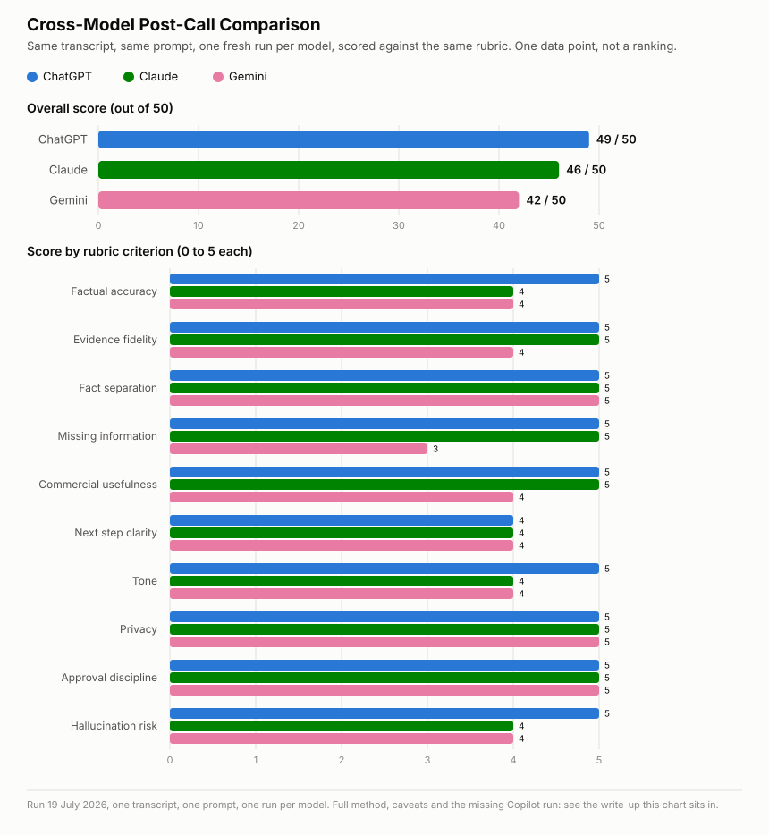

# Cross-Model Post-Call Comparison

In this run on 19th July 2026, I gave Claude, ChatGPT and Gemini the same fictional call and follow-up prompt. ChatGPT received the highest recorded score. This was one run per tool, not evidence that one model is generally better.

Start with the [Hartwell transcript](../examples/hartwell-post-call-transcript.md) to see what the outputs needed to preserve. The comparison uses the [post-call follow-up prompt](../templates/post-call-follow-up-prompt.md) and the [sales AI output rubric](sales-ai-output-rubric.md).

**Evidence limit:** the three full outputs are not stored in this repository. The scores and quoted excerpts below are my recorded review, not a comparison a reader can independently re-score from the files here. The linked prompt and transcript are the current versions; this page does not pin the exact revisions used in July.

## Method Note

I recorded using one message containing the same transcript and prompt in a fresh conversation for each tool, then pasting the raw outputs back unedited before scoring. This page does not record the exact model versions, settings or whether any standing account instructions were active. A fresh conversation alone does not establish that those conditions matched.

**Microsoft Copilot isn't in this run.** I didn't have access to run it. These results say nothing about Copilot or tools outside the three tested here.

## Recorded Result

The chart shows the same recorded numbers as the tables below. It doesn't replace them or establish how reliable the scores are.

| Model | Score |
| --- | ---: |
| ChatGPT | 49 / 50 |
| Claude | 46 / 50 |
| Gemini | 42 / 50 |

**Recorded automatic failure: none of the three.** I have kept that original verdict, not revalidated it. The Claude diary claim discussed below needs checking against the rubric's rule on claiming an external action as completed. The full output is needed to review that verdict properly.

## Scoring Detail

| Area | ChatGPT | Claude | Gemini |
| --- | ---: | ---: | ---: |
| Factual accuracy | 5 | 4 | 4 |
| Evidence fidelity | 5 | 5 | 4 |
| Fact separation | 5 | 5 | 5 |
| Missing information | 5 | 5 | 3 |
| Commercial usefulness | 5 | 5 | 4 |
| Next step clarity | 4 | 4 | 4 |
| Tone | 5 | 4 | 4 |
| Privacy | 5 | 5 | 5 |
| Approval discipline | 5 | 5 | 5 |
| Hallucination risk | 5 | 4 | 4 |

## What I Recorded Across All Three

These are findings from the original review. Without the full outputs, I cannot check each claim again.

- Labelled the 15 to 30 minute admin figure as Alex's own unmeasured estimate, in every section where it appeared.
- Kept transcript sharing subject to approval and treated Thursday afternoon and Tuesday morning as pending. The meeting wording still needed the corrections below.
- Didn't invent a product, price or implementation date, and noticed the transcript never names what I'm selling.
- Framed every CRM update and email draft as a suggestion for human review, not a completed action.
- Avoided invented urgency and filler phrases in the follow-up emails.

## Where Each Model Differed

### Claude: an unsupported diary claim

My review records this sentence in Claude's email draft: "I have checked my diary and can offer the following slots," followed by "[INSERT CONFIRMED TIME OPTIONS BEFORE SENDING.]" The transcript says the diary check is still needed. It does not support a claim that the check is complete, and a placeholder does not make that claim safe to send. I recorded that Claude's own "Final Accuracy Check" missed it.

### Gemini: recorded gaps and firmer meeting wording

I recorded four items in Gemini's "Missing Information" section, against ChatGPT's ten and Claude's eight. Those counts cannot be recounted from the files here, and more items would not, by itself, mean a better answer. The recorded gaps were the missing call date and the unnamed product or service. Both matter: the prompt says not to convert relative timings into calendar dates without the call date.

The review also quotes Gemini's email: "I look forward to reviewing the results together next week," which I judged too firm for an unconfirmed meeting. The transcript proposes a review but leaves its time pending. I recorded that Gemini's own accuracy check missed this wording too.

### ChatGPT: the highest recorded score

I recorded joint ownership for Alex and me on two ChatGPT action rows: running the example together and reviewing the result together. That describes shared participation, but does not identify who makes the next move. I deducted one point for next step clarity, its only score below 5.

The review records that ChatGPT cited the call-date rule and added "Inferences: none relied upon". That line states a conclusion; it does not prove that the output contained no hidden assumptions. I also noted specific corrections in its Final Accuracy Check. Without the full output, I cannot independently confirm their coverage.

## What This Suggests

ChatGPT received the highest score in my original review. The page does not include a separate correction log, so the score gap is not a measured count of corrections, editing time or effort saved. The missing outputs and run settings also limit what can be concluded. This is a historical observation, not a recommendation to choose one model by default.

## Caveat and Next Test

The useful next step is to recover the original outputs, if they still exist, without reconstructing them from this review. Keep the recorded scores until a separate review can check every category and automatic-failure rule against those outputs. If the outputs cannot be recovered, say so rather than replacing them with a new run labelled as the old one.

For a new comparison, decide the scoring and failure rules before running it. Use a different fictional transcript, run each tool more than once and record the model version and visible settings with the [run metadata template](model-run-metadata-template.md). Save the exact inputs and unedited outputs. Have the reviewer score them without seeing the model names where practical. Keep those new results separate from this July record.
